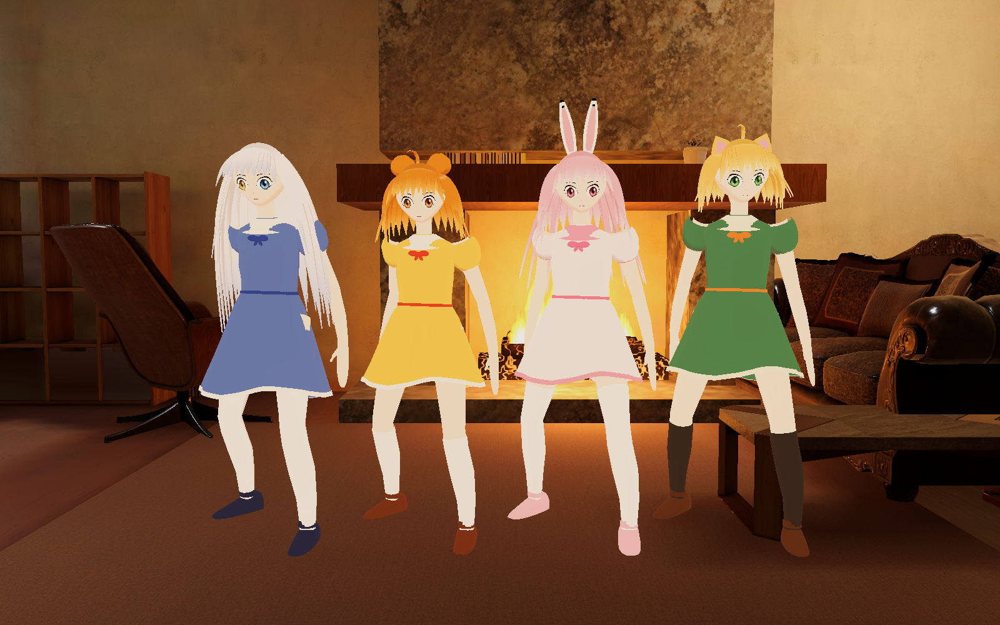

# VRtalk（White Room）— Quest 3S / Windows用 AI会話キャラクター

## ダウンロード

**v1.6.1**: PTTを押した直後からマイクで録音します。通信のミュート解除確認を待つ間の発話も保持し、短い発話を送れるようにしました。

[GitHub Releases](https://github.com/miki-826/VRtalk/releases/latest) から最新版を取得してください。付属のミニキャラ（いぬ・ロボ・うさぎ・ねこ）を作り込んだ版です。歩いたり視線を向けても目が隠れず、表情の切り替わりがなめらかになり、腕は体に埋まらず、耳やしっぽはしっかり頭や体についています。自分の3Dモデル（VRM）をアプリ内で追加することもできます（[自分のモデルを追加する](#自分のモデルを追加する)）。モデルは外部素材を使わずコードで一から生成しています。PC版と同じ操作（移動・旋回・指さし・手を振る・しゃがむ・システムキーボード入力）もQuestで使えます。

|ファイル|対象|使い方|
|---|---|---|
|`VRtalk-Quest3S.apk`|Meta Quest 3S（単体動作）|開発者モードのQuestへ `adb install -r VRtalk-Quest3S.apk`（またはSideQuest）。アプリ一覧の「提供元不明」から **White Room** を起動|
|`VRtalk-Windows.zip`|Windows 10/11 64bit（VR機器不要）|展開してフォルダーごと置き、`VRtalk-Windows/WhiteRoom.exe` を起動。操作は [PC版の遊び方](docs/DESKTOP.md)|

まずキャラクターと部屋を選び、セッション画面の「動きを試す」を開くと、接続・APIキーなしで動作を確認できます。声で会話するときは 設定 → AI → OpenAI API Key（会話）、設定 → 身体の反応 → Jev API Key（動作の判断）を入力します。キーは端末内で暗号化保存され、リポジトリやビルドには含まれません。Jevなしでも歩き回り・ジェスチャー反応は端末内のルールで動きます。

## 言葉で動かす

話しかけた内容（または「動きを試す」→「言葉で指示する」で入力した文）を、キャラクターがその通りに実行します。行き先は言葉で伝えられます。

|言い方の例|動き|
|---|---|
|「ソファの後ろに行って」「暖炉の前に立って」「テーブルの右に移動して」|その家具の前・後ろ・左・右・横（あなたから見た向き）へ歩く|
|「私の右に来て」「僕の後ろに回って」「隣に来て」|あなたの前後左右へ来る|
|「テーブルと暖炉の間に行って」|2つの物（またはあなたと物）の間へ|
|「部屋の真ん中に行って」「部屋の隅に行って」「部屋の奥に行って」|部屋の中の場所へ|
|「あそこに行って」「そこまで歩いて」|あなたが見ている床（直前に指さしていればその場所）へ|
|「夜にして」「朝に変えて」「明るくして」|部屋の時間帯を変える|
|「ソファの前で踊って」「部屋の真ん中でジャンプして」|その場所へ行ってから、そこで動く|
|「ソファの1メートル前に行って」「私の2歩右に立って」|距離を付けた場所へ|
|「ソファの後ろに行ってジャンプして」|続けて言った動きを順番に実行|

- ここまでの言い方は端末内で理解するので、APIキーなし・未接続でも動きます。行き先には床に輪の目印が出ます。入れない場所（壁の向こう・家具の中）は理由を表示して動きません。
- 端末内で理解できない言い方は、OpenAIキーがあればAIが動きを組み立てます（歩く・身振り・自由なポーズ・おもちゃの組み合わせ。できないことは身振りで表現します）。
- 床を直接指定することもできます: Questは右グリップ、PCはFキーで床を指すと、キャラクターがその場所へ歩きます。
- 自分の移動: Questは右スティックを前に倒して床を狙い、離すとその場所へテレポートします（PCはTキーを押して離す）。緑の輪は移動できる場所、赤は不可です。左スティック／WASDの移動は、壁や家具に沿って滑るように止まります。

Unity 6000.6.0f1 / Android ARM64 / IL2CPP / URP / OpenXR。
会話は **GPT-Live-1**、表情・動作は **Jev**、記憶抽出は Responses API を使用します。

## 自分のモデルを追加する

付属キャラクターのほかに、自分の3Dモデル（**VRM 0.x / 1.0**、VRoid Studioなどで作れる人型モデル）を話し相手として追加できます。Unityや再ビルドは不要です。

1. メインメニュー →「キャラクター」→「自分のモデルを追加」を開くと、モデルを置くフォルダが表示されます。
   - Windows: 「フォルダを開く」で開きます（`%USERPROFILE%\AppData\LocalLow\VibeCodingClub\White Room\Models`）。
   - Quest: QuestをPCにUSB接続し、Quest内の `Android/data/com.vibecodingclub.questai/files/Models` にコピーします（一度アプリを起動するとフォルダができます）。
2. `.vrm` ファイルを置いて「一覧を更新」を押すと、キャラクター一覧に「〇〇 · マイモデル」として出てきます。
   - 「URLから追加」で `.vrm` ファイルへの直接リンク（https://…/〇〇.vrm）を入力すると、ダウンロードしてそのまま追加します（Questでも使えます）。共有ページのURLはVRMではないため追加されません。
3. 選んで部屋を始めると、付属キャラと同じアニメーションで歩く・身振り・しゃがむ・手を伸ばすなどの動きをします。表情・まばたき・視線・口パク・髪や服の揺れは、モデル自身のVRM設定を使います。
4. 名前と性格を決めたいときは、同じ名前の `.txt` を置きます（例: `neko.vrm` と `neko.txt`）。1行目が名前、2行目以降が性格です。

大きすぎる・小さすぎるモデルは0.6〜1.9mに収まるよう自動で縮尺を合わせます。人型（Humanoid）の骨格がないファイルや壊れたファイルは、エラーを表示してメニューに戻ります。モデルの利用条件（VRMのライセンス設定）はモデルの作者の指定に従ってください。

## 開く・ビルドする

1. Unity Hubで `QuestAI` フォルダーを開く。元の `model` プロジェクトは編集していません。
2. Unity 6000.6.0f1とAndroid Build Support（SDK/NDK/OpenJDKを含む）を使用する。
3. Package Managerの解決を待つ。バージョンは `Packages/manifest.json` と `packages-lock.json` に固定済み。
4. `Assets/Scenes/Bootstrap.unity` を開く。
5. メニュー `Quest AI > Build APK`、またはPowerShellで `./tools/build.ps1` を実行し、`QuestAI/Builds/WhiteRoom-Quest3S.apk` を生成する。

シーン・表情を再生成する場合は `Quest AI > Generate content and configure`、続けて `Bake all time variants` を実行します。再生成はGeneratedとScenesの内容を更新するため、手作業で調整した場合は先に保存・バックアップしてください。通常のAPKビルドでは再生成は不要です。

自動テストはQuestAIのUnity Editorを閉じて `./tools/test.ps1` を実行します。EditMode→PlayModeの順で実行し、日時付きのXML結果とログを `artifacts` に保存します。テストは実サービスへの接続やQuest実機試験を代替しません。

グラフィック設定の再適用と全時間帯の再ベイクは `Quest AI > Upgrade room graphics and bake`。素材・照明・メモリ上の変更は [グラフィック改善](docs/GRAPHICS.md) に記録しています。キャラクターは元のWhiteChibiを維持します。

## Questでの初期設定

1. 開発者モードのQuestへAPKをインストールする（例: `adb install -r QuestAI/Builds/WhiteRoom-Quest3S.apk`）。
2. 不明な提供元のアプリから **White Room** を起動する。
3. 設定 → AI → OpenAI API Keyを入力。Liveモデルは `gpt-live-1`。
4. 設定 → 身体の反応 → Jev API Keyを入力。モデルは `jev-latest`。
5. 各接続テストを実行する。APIへのアクセス権と利用枠が必要。
6. キャラクターと部屋を選択して開始。「会話に接続」を押し、PTTを押している間だけ話す。
7. 初回マイク権限ダイアログを許可した後、もう一度PTTを押す。

UIは右コントローラーのトリガー、または手のピンチで操作します。AボタンまたはXボタンでPTTを操作できます。PC版のキー操作もQuestで使えます: 左スティックで移動（WASD）、右スティックを左右で向きを変える、右スティックを前に倒して離すとテレポート（T）、右グリップで指さし（F。物を指すとそれを見に行き、床を指すとその場所へ歩く）、Yボタンで手を振る（H）、左スティック押し込みでしゃがむ・立つ（C）。文字入力画面の「キーボード」でQuestのシステムキーボード（漢字変換・英数字・音声入力）も使えます（PCのIME入力に相当）。1回最大60秒。処理・発話中の重複録音を防ぎます。PCのEditorではマウス、右ドラッグ視点、UキーPTTを使用します。EditorのAPIキーはメモリ内だけに保持し、終了すると消えます。

## 収録内容

- Bedroom / Living Room / Cafe、朝・昼・夕方・夜・ローカル時刻による自動選択。
- キャラクターは外部モデルを使わずコードで一から生成したミニキャラ4体「しろ · いぬ」（垂れ耳・バンダナ）「こはく · ロボ」（光る顔のモニター・アンテナ）「もも · うさぎ」（長い耳・リボン・丸いしっぽ）「むぎ · ねこ」（猫耳・鈴の首輪・しっぽ）と、CC0モデルの「ロボ · 好奇心」。トゥーンシェーダー（MToon）で描画し、7感情の表情・まばたき・目の動き・母音の口の形、耳やしっぽの揺れに対応。全員が家具を避けて部屋を歩く。声と記憶はプロフィールごとに分離。生成コードは `QuestAI/Assets/Editor/MascotCharacterBuilder.cs`、再生成はメニュー `Quest AI > Build mascot characters`。以前の白いちびキャラ（WhiteChibi）は、アニメーションを共有する生成元データとして残しています。
- 読点なしの連続指示、動作ごとの速さ・秒数、左右の手振り・角度指定に対応。例:「ゆっくり2メートル前に歩いて右に90度回って」「4秒両手を上げて」。詳細と追加キャラクターの再生成方法は [動作・追加キャラクター](docs/MOTION_COMPANIONS.md)。
- 腕を上げたまま歩く・旋回する、床に座ったまま手を振る、移動する対象を見続ける。「動きを試す」のボタンと「言葉で指示する」で、接続なしでも試せます。
- 言葉で説明した場所への移動、床の指さし、時間帯の変更、プレイヤーのテレポート（[言葉で動かす](#言葉で動かす)）。おもちゃ遊び（ボール・積み木・回転おもちゃ）は会話画面の「おもちゃで遊ぶ」から。
- 瞬き、頭・上半身・目の追従、呼吸、7感情、ジェスチャー、振幅ベースの口パク。
- 日本語メニュー、VRキーボード、8分類の設定、字幕3モード。
- Android SQLiteで会話・記憶・関係性・状態・設定を保存。Continueで前回の部屋とキャラクターを復元。
- Android KeystoreのAES-GCM鍵でAPIキーを暗号化。会話DB、PlayerPrefs、ソースへキーを保存しません。

配布ファイルの作成: Windows/Questをビルドしてから `./tools/package-release.ps1 -Version 1.6.1`。配布ZIP・APK・SHA256チェックサムを `artifacts/releases/v1.6.1/` に作成します。

## 会話構成の変更点

`main.md` のSTT→LLM→TTSの直列処理は、追加指定のGPT-Live-1に合わせて、24kHz PCMを専用WebSocketへ連続送信する方式へ変更しました。Liveが音声認識・会話生成・音声出力を担当します。Jevと記憶検索は文字起こしを受けて並行実行し、結果をLiveへ送ります。従ってJev完了を待ってから音声生成する直列パイプラインではありません。

録音中だけ実マイク音声を送信し、離した後はミュート応答を確認します。Live接続を維持する間は無音PCMを送ります。明示的な発話完了イベントがないため、音声キューの出力振幅と文字起こしの静止時間でアプリ内の発話終了を判定します。GPT-Liveの全二重機能を用いた自動割り込み操作はMVPでは提供しません。

Live接続は切断ボタン、画面遷移、Pause/Focus喪失、120秒の無操作で閉じます。復帰後のマイク開始には再度PTTが必要です。音声はOpenAI、会話テキスト・状態はOpenAIとJevへ送られます。接続時間などに応じてサービス利用料金が発生します。録音音声は永続保存しません。

VAD、自発会話、MRは今回の範囲外です。キャラクターの環境認識と部屋内の歩行は [環境認識・歩行](docs/AWARENESS.md) を参照。サービスキーと接続済み実機がない環境での検証は、実際のAPI接続やQuest動作の成功を意味しません。

詳細: [実装構成](docs/ARCHITECTURE.md)、[実機確認手順](docs/QUEST_CHECKLIST.md)、[ライセンス](docs/THIRD_PARTY.md)、[検証結果](docs/VALIDATION.md)、[Claude Code引き継ぎ](docs/CLAUDE_HANDOFF.md)。
