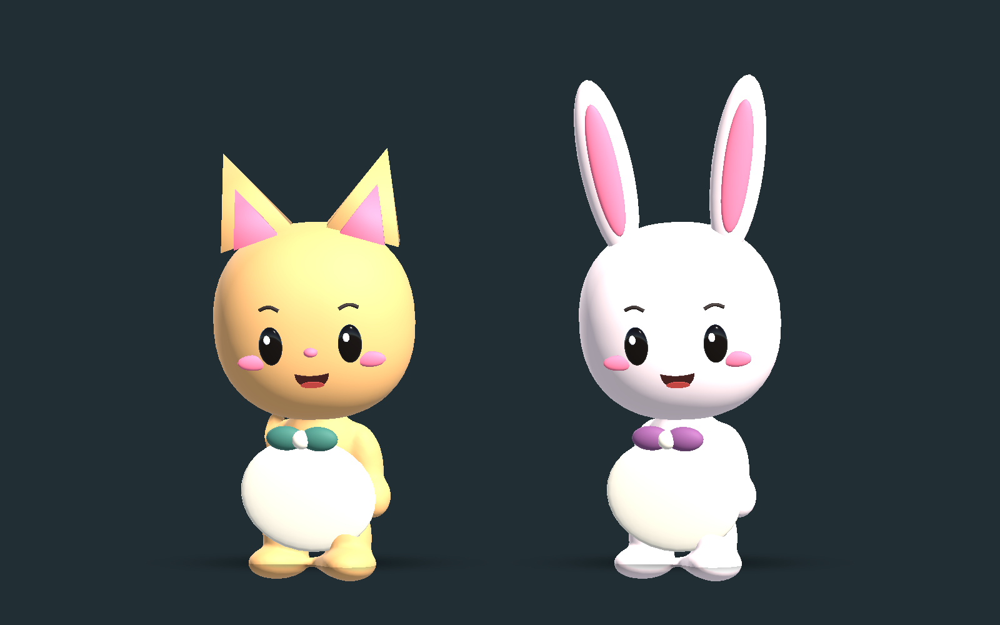

# VRtalk（White Room）— Quest 3S / Windows用 AI会話キャラクター

## ダウンロード

[GitHub Releases](https://github.com/miki-826/VRtalk/releases/latest) から最新版を取得してください。**v1.1.0** は、もも・むぎと自然な動作、APIキーなしで使える「動きを試す」を収録しています。

|ファイル|対象|使い方|
|---|---|---|
|`VRtalk-Quest3S.apk`|Meta Quest 3S（単体動作）|開発者モードのQuestへ `adb install -r VRtalk-Quest3S.apk`（またはSideQuest）。アプリ一覧の「提供元不明」から **White Room** を起動|
|`VRtalk-Windows.zip`|Windows 10/11 64bit（VR機器不要）|展開してフォルダーごと置き、`VRtalk-Windows/WhiteRoom.exe` を起動。操作は [PC版の遊び方](docs/DESKTOP.md)|

まずキャラクターと部屋を選び、セッション画面の「動きを試す」を開くと、接続・APIキーなしで動作を確認できます。声で会話するときは 設定 → AI → OpenAI API Key（会話）、設定 → 身体の反応 → Jev API Key（動作の判断）を入力します。キーは端末内で暗号化保存され、リポジトリやビルドには含まれません。Jevなしでも歩き回り・ジェスチャー反応は端末内のルールで動きます。

Unity 6000.6.0f1 / Android ARM64 / IL2CPP / URP / OpenXR。
会話は **GPT-Live-1**、表情・動作は **Jev**、記憶抽出は Responses API を使用します。

## 開く・ビルドする

1. Unity Hubで `QuestAI` フォルダーを開く。元の `model` プロジェクトは編集していません。
2. Unity 6000.6.0f1とAndroid Build Support（SDK/NDK/OpenJDKを含む）を使用する。
3. Package Managerの解決を待つ。バージョンは `Packages/manifest.json` と `packages-lock.json` に固定済み。
4. `Assets/Scenes/Bootstrap.unity` を開く。
5. メニュー `Quest AI > Build APK`、またはPowerShellで `./tools/build.ps1` を実行し、`QuestAI/Builds/WhiteRoom-Quest3S.apk` を生成する。

シーン・表情を再生成する場合は `Quest AI > Generate content and configure`、続けて `Bake all time variants` を実行します。再生成はGeneratedとScenesの内容を更新するため、手作業で調整した場合は先に保存・バックアップしてください。通常のAPKビルドでは再生成は不要です。

自動テストはQuestAIのUnity Editorを閉じて `./tools/test.ps1` を実行します。EditMode→PlayModeの順で実行し、日時付きのXML結果とログを `artifacts` に保存します。テストは実サービスへの接続やQuest実機試験を代替しません。

グラフィック設定の再適用と全時間帯の再ベイクは `Quest AI > Upgrade room graphics and bake`。素材・照明・メモリ上の変更は [グラフィック改善](docs/GRAPHICS.md) に記録しています。キャラクターは元のWhiteChibiを維持します。

## Questでの初期設定

1. 開発者モードのQuestへAPKをインストールする（例: `adb install -r QuestAI/Builds/WhiteRoom-Quest3S.apk`）。
2. 不明な提供元のアプリから **White Room** を起動する。
3. 設定 → AI → OpenAI API Keyを入力。Liveモデルは `gpt-live-1`。
4. 設定 → 身体の反応 → Jev API Keyを入力。モデルは `jev-latest`。
5. 各接続テストを実行する。APIへのアクセス権と利用枠が必要。
6. キャラクターと部屋を選択して開始。「会話に接続」を押し、PTTを押している間だけ話す。
7. 初回マイク権限ダイアログを許可した後、もう一度PTTを押す。

UIは右コントローラーのトリガー、または手のピンチで操作します。右AボタンでもPTTを操作できます。1回最大60秒。処理・発話中の重複録音を防ぎます。PCのEditorではマウス、右ドラッグ視点、UキーPTTを使用します。EditorのAPIキーはメモリ内だけに保持し、終了すると消えます。

## 収録内容

- Bedroom / Living Room / Cafe、朝・昼・夕方・夜・ローカル時刻による自動選択。
- 最初の滑らかな白いちびキャラを使う「しろ・穏やか」「こはく・元気」、CC0モデルの「ロボ · 好奇心」、長い耳の「もも · うさぎ」、しっぽの揺れる「むぎ · ねこ」。全員が家具を避けて部屋を歩く。声と記憶はプロフィールごとに分離。試作したピクセル版は別データとして保存し、現在は使用していません。
- 読点なしの連続指示、動作ごとの速さ・秒数、左右の手振り・角度指定に対応。例:「ゆっくり2メートル前に歩いて右に90度回って」「4秒両手を上げて」。詳細と追加キャラクターの再生成方法は [動作・追加キャラクター](docs/MOTION_COMPANIONS.md)。
- 腕を上げたまま歩く・旋回する、床に座ったまま手を振る、移動する対象を見続ける。「動きを試す」で停止・繰り返しも操作できます。
- 瞬き、頭・上半身・目の追従、呼吸、7感情、ジェスチャー、振幅ベースの口パク。
- 日本語メニュー、VRキーボード、8分類の設定、字幕3モード。
- Android SQLiteで会話・記憶・関係性・状態・設定を保存。Continueで前回の部屋とキャラクターを復元。
- Android KeystoreのAES-GCM鍵でAPIキーを暗号化。会話DB、PlayerPrefs、ソースへキーを保存しません。

配布ファイルの作成: Windows/Questをビルドしてから `./tools/package-release.ps1 -Version 1.1.0`。配布ZIP・APK・SHA256チェックサムを `artifacts/releases/v1.1.0/` に作成します。

## 会話構成の変更点

`main.md` のSTT→LLM→TTSの直列処理は、追加指定のGPT-Live-1に合わせて、24kHz PCMを専用WebSocketへ連続送信する方式へ変更しました。Liveが音声認識・会話生成・音声出力を担当します。Jevと記憶検索は文字起こしを受けて並行実行し、結果をLiveへ送ります。従ってJev完了を待ってから音声生成する直列パイプラインではありません。

録音中だけ実マイク音声を送信し、離した後はミュート応答を確認します。Live接続を維持する間は無音PCMを送ります。明示的な発話完了イベントがないため、音声キューの出力振幅と文字起こしの静止時間でアプリ内の発話終了を判定します。GPT-Liveの全二重機能を用いた自動割り込み操作はMVPでは提供しません。

Live接続は切断ボタン、画面遷移、Pause/Focus喪失、120秒の無操作で閉じます。復帰後のマイク開始には再度PTTが必要です。音声はOpenAI、会話テキスト・状態はOpenAIとJevへ送られます。接続時間などに応じてサービス利用料金が発生します。録音音声は永続保存しません。

VAD、自発会話、MRは今回の範囲外です。キャラクターの環境認識と部屋内の歩行は [環境認識・歩行](docs/AWARENESS.md) を参照。サービスキーと接続済み実機がない環境での検証は、実際のAPI接続やQuest動作の成功を意味しません。

詳細: [実装構成](docs/ARCHITECTURE.md)、[実機確認手順](docs/QUEST_CHECKLIST.md)、[ライセンス](docs/THIRD_PARTY.md)、[検証結果](docs/VALIDATION.md)、[Claude Code引き継ぎ](docs/CLAUDE_HANDOFF.md)。
