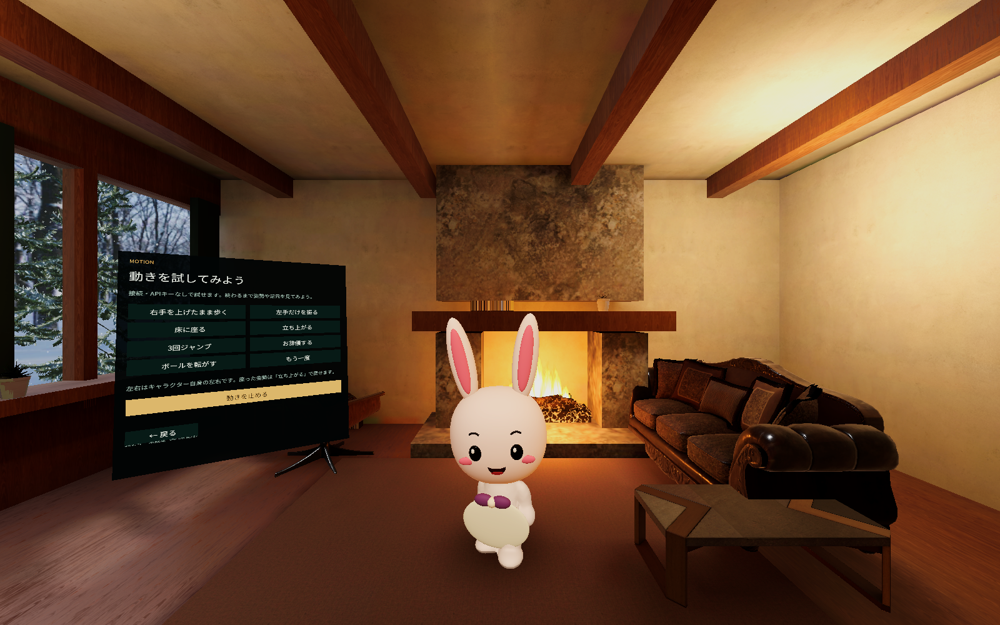

# 動作と追加キャラクター（2026-10-25）

## 話した動作の再現

端末内の日本語パーサーが、読点のない連続した指示も動作に分けて実行します。理解できない指示が含まれると、既存のAI動作プランナーへ渡します。APIキーなしでも、端末内で理解できた指示は実行できます。

試せる例:

- 「ゆっくり2メートル前に歩いて右に90度回って早く3回ジャンプして」
- 「ボールを出してこっちに転がして」
- 「左手だけを振って」
- 「右手を90度上げて」
- 「4秒両手を上げて」
- 「4秒しゃがんでから左を向いて」
- 「3秒待ってからお辞儀して」
- 「10秒踊って」
- 「右手を上げたまま2歩前に歩いて」
- 「両手を広げたまま左に90度向いて」
- 「床に座って」→「左手だけを振って」→「立って」
- 「5秒ボールを見て」

左右はキャラクター自身の左右です。速さと感情は各節に適用します。身体の動作にも slow / normal / hurry を適用し、秒数を明示した場合はその時間を優先します。`MotionStep.duration` は動作時間、`amount` は従来どおり回数・距離・角度です。キーフレーム動作の指定時間は、通常姿勢へ戻る補間も含みます。

セッション画面の「動きを試す」では、接続・APIキー・マイクなしで8つのボタンから動作を試せます。「もう一度」は直前に試した指示を繰り返し、「動きを止める」は実行中の歩行や姿勢保持を中断します。実行中の手順数と完了・失敗を日本語で表示します。

腕を上げたり広げたままの移動・旋回・待機・注視に対応しています。移動や旋回の `keys` が1個の腕だけのキーなら、`BodySystem` が歩行アニメーションと独立した腕の姿勢を滑らかに重ねます。ジャンプなど未対応の組み合わせは、腕を無視せずAIプランナーに渡します。

保持する腕は、モデル固有の初期回転角ではなく実際の上腕→肘の向きから合わせます。白い2プロフィール・うさぎ・猫・ロボで、腕を上げる方向と左腕を水平にする方向が一致することを検証しています。

床に座る指示は、立ち上がる・歩く・ジャンプするなどの指示が来るまで座り続けます。座ったまま手を振ることもできます。秒数付きならその時間で立ち上がります。注視中は対象の現在位置を追い、動いたユーザーやおもちゃも追跡します。「見ないで」のような否定指示で逆に見ることはありません。

歩行は実際の移動速度も滑らかに加減速し、最終地点の前で減速します。ジャンプは踏み切り・放物線の上下動・着地を組み合わせます。向きを変える処理同士の競合を防ぎ、追従終了時には残った歩行も止めます。家具やおもちゃへ到達できなかったときは、その場で操作を続けず失敗を報告します。

WhiteChibiへのHumanoidアニメーション適用で身体が後ろを向いていた問題は、骨盤の向きを180度補正して修正しました。移動や旋回の基準と見た目の前向きをそろえています。「右手を上げたまま左手を振る」などの組み合わせでは、保持する腕と動かす腕のキーを分けます。

一度のプランは最大10動作、繰り返しは最大10回、移動は1動作5mです。身体モーションの時間は30秒まで、待機・追従・注視・しゃがむ・座る時間は60秒までです。部屋の歩行可能範囲と家具の配置が優先されるため、指定距離をそのまま進めないことがあります。新しい言い回しや未対応の同時動作はAIプランナーに依存します。

## もも・むぎ

メインメニューの「キャラクター」で、既存の3プロフィールに加えて以下の2体を選べます。

|キャラクター|見た目・性格|
|---|---|
|もも · うさぎ|淡い桃色、長い耳、ローズ色の内耳と頬、紫のリボン、丸いしっぽ。人なつっこく優しい|
|むぎ · ねこ|はちみつ色、三角の耳、小さな鼻、緑のリボン、カーブしたしっぽ。好奇心旺盛でマイペース|

WhiteChibiの骨格・表情メッシュ・Humanoidアニメーションを共有し、専用のマテリアルと3Dパーツを追加しています。既存の会話、口パク、表情、手のIK、歩行、物の持ち運びに対応します。耳としっぽは歩く速さ・回転・感情に応じてばね状に揺れます。声の指示・性格・記憶はプロフィールごとに分かれます。

生成済みPrefabは `QuestAI/Assets/Generated/Companions/`、プロフィールは `QuestAI/Assets/Resources/Profiles/bunny.asset` と `cat.asset`。再生成は Unity の `Quest AI > Add bunny and cat companions`。確認画像付きのバッチ実行は `QuestAI.Editor.CuteCharacterBuilder.BuildAndReview` です。

キャラクター選択画面は5人のボタンと選択中の性格説明を表示します。説明を選択中だけにすることで、追加したキャラクターと戻るボタンが重ならないようにしました。

実サービスの音声認識やQuest実機での追従精度・負荷は、ローカルテストとは別に確認が必要です。
